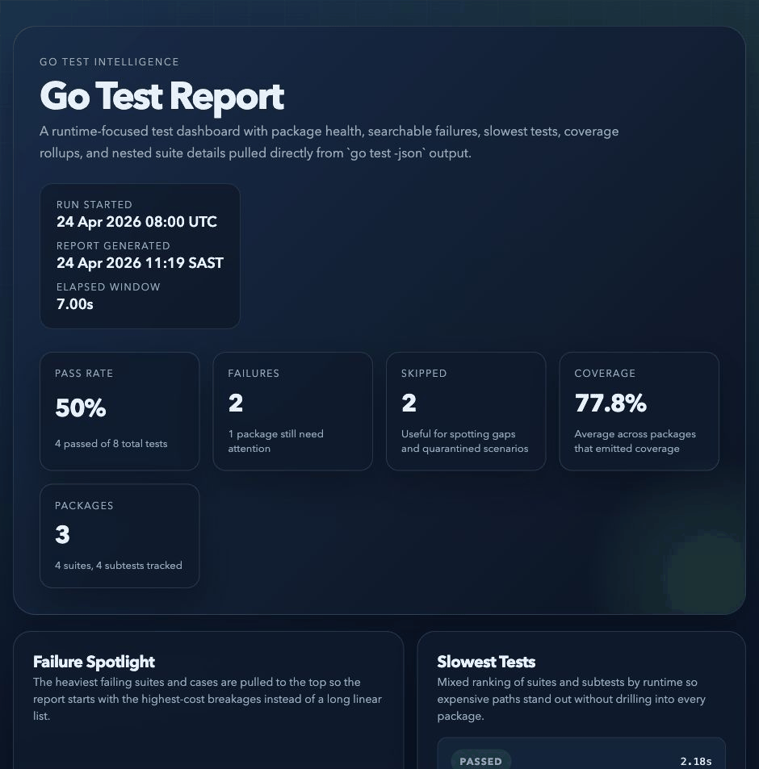

# go-test-html-report
`go-test-html-report` generates a polished HTML dashboard from `go test -json` output.

## Installation
```shell
$ go install github.com/Thatooine/go-test-html-report@latest
```

## Usage
To use the `go-test-html-report` with a go test log file use
 ```shell
 $ go-test-html-report -f ./test.log -o ./reportDir
 ```
where `./test.log` generated by calling
 ```shell
 $ go test -v -cover -json  ./...  |tee test.log 
 ```
Another way to use `go-test-html-report` is by reading the logs from stdout. Use the following command.
 ```shell
 $  go test -v -cover -json  ./... | go-test-html-report
 ```

## What Changed
- A structured dashboard replaces the previous flat card list.
- Package cards now show pass rate, failure counts, coverage bars, and nested suite health.
- Failure output is promoted into a spotlight panel instead of being buried in raw logs.
- Slow suites and subtests are ranked globally to surface expensive paths quickly.
- Search and status filters make large reports easier to inspect.
- The tool now uses only the Go standard library for runtime dependencies.

## Demo


The HTML report groups test suites by package and nested subtests by suite. Failing packages open by default, suite and subtest output is preserved for investigation, and coverage is summarized per package and across the run when `-cover` is enabled.

To generate the bundled demo report locally:
```shell
$ go run . -f ./demo/sample-go-test.jsonl
```

## Contribute & Support

- Add a GitHub Star
- Suggest [new features, ideas and optimizations](https://github.com/Thatooine/go-test-html-report/issues)
- [Report issues](https://github.com/Thatooine/go-test-html-report/issues)
